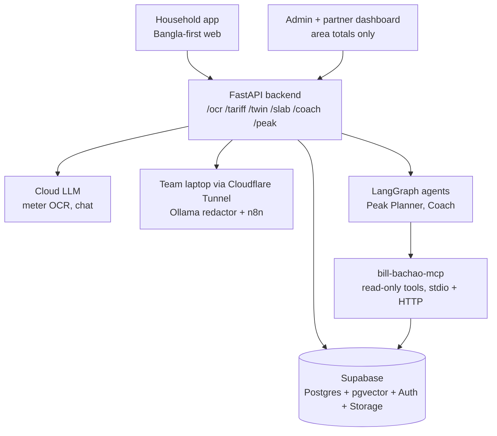

# Bill Bachao — architecture

**Rule:** the LLM reads and explains; plain, tested code calculates every taka and kWh.

| Component | Status (preliminary) |
|---|---|
| Tariff calculator (BERC June 2026) | Built, tested in Python and JS (`api/tariff.py`, `web/logic.js`) |
| Home twin + Slab Guard maths | Built, tested (`api/twin.py`) |
| Meter OCR | Live: Supabase Edge Function `ocr-meter` used by the demo's Read my meter tab (photo not stored, daily caps); same prompt as `api/main.py`. Tested on 2 real meter photos from a team member's home: the whole-kWh reading matched both times and the decimal digit matched on the retaken second photo; it also picked the correct present reading from a DPDC bill. Small test — more meters, lighting and angles before the final. |
| Local bill redactor | Written (`local/redactor.py`, Tesseract + Ollama qwen2.5); not yet run |
| MCP server | Built and tested (`mcp/server.py`, stdio + Streamable HTTP at `/mcp`; `tests/test_mcp.py`) |
| Database schema + RLS | Built (`db/schema.sql`) |
| Public demo | Built (`web/`, simulated household) |
| Coach retrieval: contextual chunks, hybrid search (vector + full-text, RRF), knowledge graph | Built, live in Supabase (`rag/`, `supabase/`); 15/15 top-3 and 15/15 first on our test set |
| Coach answer generation (Gemini, grounded in sources) | Written; switches on when the `GEMINI_API_KEY` secret is set |
| Peak Hour Hero verification, n8n workflows | Planned for the final |
