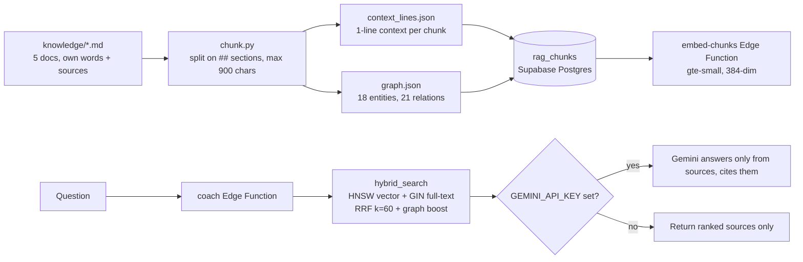

# Bill Bachao coach — RAG pipeline

**Live endpoint:** `POST https://vkakhpqfhugaponhgubg.supabase.co/functions/v1/coach` with body `{"question": "...", "k": 3}`



| Technique | Where |
|---|---|
| Structure-aware chunking (by `##` section, paragraph split above 900 chars) | `rag/chunk.py` → 28 chunks |
| Contextual retrieval (a one-line context written per chunk, embedded and indexed with it) | `rag/context_lines.json` (lines written by Claude at build time, reviewed by the team) |
| Vector search (gte-small embeddings, HNSW cosine index) | `supabase/functions/embed-chunks`, migration |
| Full-text search (`tsvector` generated column, GIN index) | migration |
| Hybrid fusion (reciprocal rank fusion, k = 60) | `hybrid_search()` |
| Knowledge graph (entities, relations, chunk links; boost + related topics) | `rag/graph.json`, `kg_*` tables, `related_topics()` |
| Guardrails in the answer prompt (no bill maths by the LLM, AC ≤ 27 C, fans never off, no medical advice) | `supabase/functions/coach/index.ts` |

## Retrieval test (`eval_results.json`)
15 questions (14 English, 1 Bangla), each with the chunk(s) that should come back, run against the live coach:

| Metric | Result |
|---|---|
| Correct chunk in top 3 | 15 / 15 |
| Correct chunk ranked first | 14 / 15 |
| MRR@3 | 0.967 |

This is a small set we wrote ourselves, so it is a sanity check, not a benchmark. Generated answers have not been tested yet: the live function runs in retrieval-only mode until a `GEMINI_API_KEY` secret is added.

## Rebuild
```bash
python rag/chunk.py                        # knowledge/*.md -> rag/chunks.json
# load rag/load.sql in the Supabase SQL editor (chunks, graph, links)
# then call embed-chunks until "remaining": 0
curl -X POST "https://<project>.supabase.co/functions/v1/embed-chunks?n=4"
```
